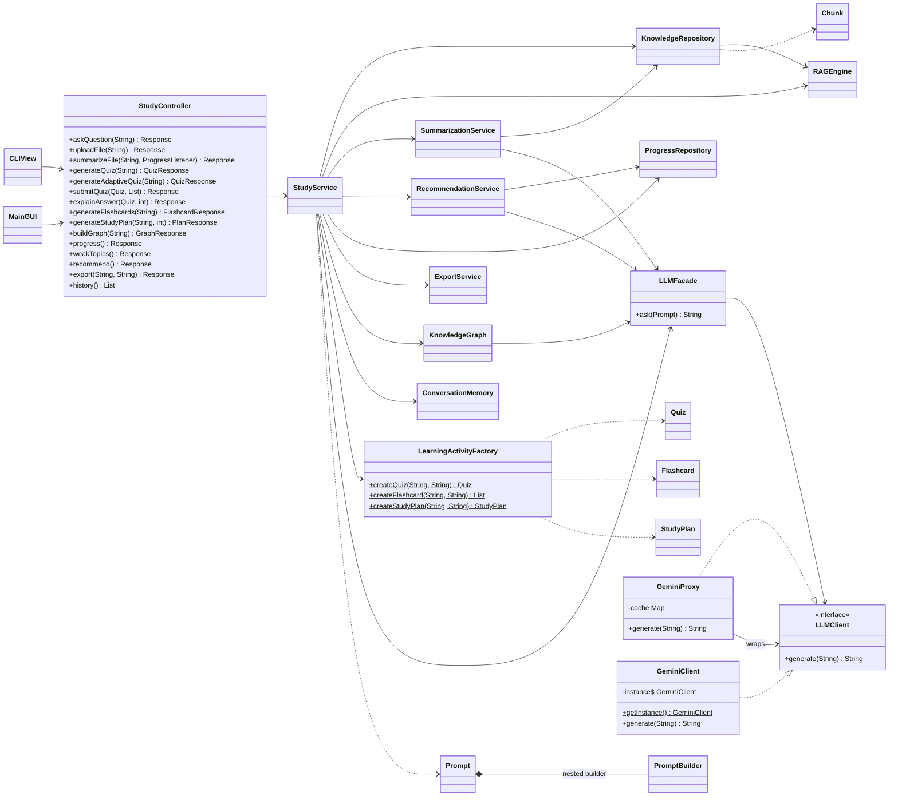

# EECS3311 Stage 2 – Implementation Report

**AI Study and Learning Agent**
Avin Beheshtipour · Repository: <https://github.com/avinbeheshtipour/EECS3311>

> **Feature IDs in this report.** All IDs F01–F12 below are the **Stage 1 report IDs**. During development, commit messages used working labels that differ from the Stage 1 numbering (for example, commit `cd000bf` "F01 basic AI Q&A" implements Stage 1 **F05**). The table in Section 2 gives the commit label for every feature, so each commit can be traced to its Stage 1 feature. New features that were not in Stage 1 are numbered **N1–N5**.

---

## 1. Project Overview and Implementation Status

The AI Study and Learning Agent is a Java 17 desktop application for university students. A student uploads course materials (PDF or TXT), asks questions about them, and generates study activities: summaries, quizzes, flashcards, study plans and concept graphs. The agent tracks quiz and flashcard results, finds the student's weakest topics, recommends what to study next, chooses quiz difficulty automatically, and explains quiz answers. Every feature can be used from both a command-line interface (`CLIView`) and a Swing desktop window (`MainGUI`).

**LLM integration.** The agent calls Google Gemini (`gemini-3.5-flash-lite`) through its REST API. All requests pass through `LLMFacade` → `GeminiProxy` (cache and retry) → `GeminiClient` (one shared connection). The API key is read from a local `.env` file that is never committed.

**Agent behaviour.** The AI component goes beyond forwarding prompts:
- **Retrieval:** uploaded materials are split into ~200-word chunks, and the most relevant chunks are added to each prompt (RAG).
- **Multi-step execution:** documents are summarized chunk by chunk, then the partial summaries are merged into one.
- **Memory:** the questions asked, quiz scores and flashcard results are kept for the session and used by later features.
- **Decision making:** quiz difficulty is chosen from past accuracy, and the weakest topic is selected from progress data.
- **Planning:** a topic is broken into day-by-day milestones.

**Status.** 10 of the 12 Stage 1 features are implemented, some with documented changes. One is replaced by a related feature (F04 → N4 Concept Graph), and one is removed (F01 Course Creation). Five new features were added. All implemented features run in both the CLI and the GUI.

**Known limitations** (details in Section 6): data is kept only for the current session; there are no courses; quizzes are multiple choice only; retrieval matches keywords rather than meaning.

---

## 2. Feature to Implementation Mapping

### 2.1 Summary

| Feature | Stage 1 ref | Status | Commit label |
|---|---|---|---|
| F01 Course Creation | F01 | **Removed** | – |
| F02 Upload Learning Materials | F02 | Implemented (modified) | F02 |
| F03 Document Summarization | F03 | Implemented (modified) | F06 |
| F04 Concept Extraction | F04 | **Replaced** by N4 (partial) | – |
| F05 Question Answering Over Materials | F05 | Implemented | F01 |
| F06 Personalized Study Plan Generation | F06 | Implemented (modified) | F05 |
| F07 Flashcard Generation | F07 | Implemented (modified) | F04 |
| F08 Quiz Generation | F08 | Implemented (modified) | F03 |
| F09 Automatic Quiz Grading | F09 | Implemented (modified) | F03 |
| F10 Answer Explanation | F10 | Implemented | F10/F11/F12 (Nov 10) |
| F11 Weak-Topic Identification | F11 | Implemented (modified) | F10/F11/F12 (Nov 10) |
| F12 Adaptive Question Difficulty | F12 | Implemented (modified) | F10/F11/F12 (Nov 10) |
| N1 Progress Tracking | New | Implemented | F07 |
| N2 Export to Markdown/PDF | New | Implemented | F08 |
| N3 Study Recommendation | New | Implemented | F09 |
| N4 Concept Graph | New (replaces F04) | Implemented | F11 (graph) |
| N5 Q&A History | New | Implemented | F12 (history) |

Every request follows the same path: **View** (`CLIView` or `MainGUI`) → **`StudyController`** (validates input, turns errors into a `Response`) → **`StudyService`** (model) → the classes listed below → **`LLMFacade`** when AI is needed. This shared path is not repeated in each entry.

### 2.2 Details per feature

**F01 – Course Creation** · Removed
- **What changed:** there are no `Course`, `CourseController` or `CourseService` classes. All uploaded material goes into one shared knowledge base. See Section 4.
- **Video:** not applicable.

**F02 – Upload Learning Materials** · Implemented (modified) · Deterministic
- **Classes and responsibilities:**
  - `KnowledgeRepository` reads the file and splits its text into chunks.
  - `Chunk` holds one piece of text (`id`, `content`, `source`).
  - `RAGEngine` stores chunks for retrieval.
  - The CLI command is `upload <file>`; the GUI uses the toolbar's **Upload** button.
- **Key methods:** `KnowledgeRepository.upload(Path)`, `readChunks(Path)`, `readText(Path)`, `split(String, String)`; `RAGEngine.index(Chunk)`; `StudyService.uploadFile(Path)`; `StudyController.uploadFile(String)`.
- **How the classes work together:** the controller checks the path. `KnowledgeRepository` extracts the text (PDFBox for PDFs, UTF-8 for TXT) and splits it into 200-word `Chunk`s. Each chunk is then passed to `RAGEngine.index`.
- **Error cases:** unsupported file types, missing files, folders, unreadable files, password-protected or damaged PDFs, and files with no text each give a clear message.
- **Changes from Stage 1:** no course id is attached to uploads, there is no file-size limit, and there is no `Material` object (chunks are stored directly).
- **Design patterns:** MVC.
- **Video:** *[link + timestamp]*

**F03 – Document Summarization** · Implemented (modified) · Hybrid
- **Classes and responsibilities:** `SummarizationService` summarizes each section, then merges the results; `KnowledgeRepository` provides the chunks; `Prompt` builds each request.
- **Key methods:** `SummarizationService.summarize(Path, ProgressListener)`, `groupIntoSections(List<Chunk>)`, `summarizeSection(String)`, `merge(String, List<String>)`.
- **How the classes work together:**
  1. The file is read into chunks without adding it to the knowledge base.
  2. Each section is sent to Gemini with the prompt "Summarize this in 3 bullet points". Large files are grouped into at most 30 sections.
  3. A final call merges the section summaries into one overview with key points.
  
  The views show progress after each section.
- **Changes from Stage 1:** the summary is shown but not stored, and large files are always processed in sections.
- **Design patterns:** Builder, Facade, Proxy, Singleton.
- **Video:** *[link + timestamp]*

**F04 – Concept Extraction** · Replaced by N4 (partial)
- **What changed:** concepts appear as nodes in the concept graph (N4). They aren't stored as `Concept` objects with definitions. See Section 4.
- **Video:** see N4.

**F05 – Question Answering Over Materials** · Implemented · Hybrid
- **Classes and responsibilities:** `RAGEngine` finds relevant chunks; `Prompt` builds the request; `LLMFacade` sends it; `ConversationMemory` records the question and answer.
- **Key methods:** `StudyService.askQuestion(String)`, `RAGEngine.retrieve(String)`, `LLMFacade.ask(Prompt)`, `ConversationMemory.add(String, String)`.
- **How the classes work together:** `RAGEngine.retrieve` scores every chunk by the question's keywords (common filler words are ignored) and returns the best 3. `StudyService` builds a `Prompt` with the question as the topic, the chunks as context, and an instruction to say when the material doesn't cover the question. The answer is saved to `ConversationMemory` (N5).
- **Where it's used:** the CLI command `ask <question>` (or just type the question) and the GUI's **Ask** tab.
- **Design patterns:** MVC, Builder, Facade, Proxy, Singleton.
- **Video:** *[link + timestamp]*

**F06 – Personalized Study Plan Generation** · Implemented (modified) · Hybrid
- **Classes and responsibilities:** `LearningActivityFactory` parses the reply into a `StudyPlan`; `StudyPlan` holds the topic, milestones and duration.
- **Key methods:** `StudyService.generateStudyPlan(String, int)`, `LearningActivityFactory.studyPlanFormat(int)`, `createStudyPlan(String, String)`.
- **How the classes work together:** the prompt includes matching uploaded material and asks for milestones covering days 1 to N. The factory parses lines like "Day 1:" and "Days 2-3:" into a `StudyPlan`; the duration is the last day covered. The plan can then be exported (N2).
- **Where it's used:** `plan <topic> <days>` in the CLI; the GUI's **Study Plan** tab, with a days field limited to 1–365.
- **Changes from Stage 1:** the input is a topic and a number of days, rather than exam date, daily hours and weak topics. Milestones are labelled strings, not `StudySession` objects.
- **Design patterns:** Factory, Builder, Facade.
- **Video:** *[link + timestamp]*

**F07 – Flashcard Generation** · Implemented (modified) · Hybrid
- **Classes and responsibilities:** `Flashcard` stores the front and back, `timesSeen` and `timesCorrect`, and computes `masteryScore()`; `LearningActivityFactory` parses the cards; `StudyService.nextFlashcard` chooses the order cards are reviewed in.
- **Key methods:** `StudyService.generateFlashcards(String)`, `LearningActivityFactory.createFlashcard(String, String)`, `Flashcard.recordAnswer(boolean)`, `StudyService.nextFlashcard(List, Flashcard)`, `StudyController.finishFlashcards(String, List)`.
- **How the classes work together:**
  1. Gemini generates 10 Q:/A: cards using matching uploaded material.
  2. A review session shows each card. The user flips it and marks it as known or missed.
  3. `nextFlashcard` picks the weakest unlearned card next and never shows the same card twice in a row (spaced repetition).
  4. When the session ends, the result is saved to N1.
- **Where it's used:** `flashcard <topic>` in the CLI; the GUI's **Flashcards** tab with Flip, Got it, Missed it and End session buttons.
- **Changes from Stage 1:** cards are generated from a topic rather than a chosen material, the card count is fixed at 10, and the review session is new.
- **Design patterns:** Factory, Builder, Facade.
- **Video:** *[link + timestamp]*

**F08 – Quiz Generation** · Implemented (modified) · AI-based
- **Classes and responsibilities:** `LearningActivityFactory` parses the model's numbered questions into a `Quiz`, tolerating Markdown and other formatting differences; `Quiz` holds the questions and answer letters.
- **Key methods:** `StudyService.generateQuiz(String)`, `LearningActivityFactory.createQuiz(String, String)`, `QUIZ_FORMAT`.
- **How the classes work together:** the prompt asks for exactly 5 multiple-choice questions in a strict layout. Incomplete questions are skipped, and if none can be parsed the user is asked to try again.
- **Where it's used:** `quiz <topic>` in the CLI; the GUI's **Quiz** tab.
- **Changes from Stage 1:** multiple choice only, and the user can't choose a quiz type or difficulty. Difficulty is only set by F12.
- **Design patterns:** Factory, Builder, Facade.
- **Video:** *[link + timestamp]*

**F09 – Automatic Quiz Grading** · Implemented (modified) · Deterministic
- **Classes and responsibilities:** `Quiz` grades the answers; `StudyController.submitQuiz` builds the score and corrections; `ProgressRepository` stores the result.
- **Key methods:** `Quiz.grade(List<String>)`, `Quiz.isCorrect(int, String)`, `StudyController.submitQuiz(Quiz, List<String>)`, `StudyService.saveQuizResult(Quiz)`.
- **How the classes work together:** answers are compared with the correct letters, and skipped questions count as wrong. The score and corrections are shown, and the result (topic, score, date) is saved.
- **Changes from Stage 1:** there is no short-answer grading and no "Pending Review" status, because quizzes only contain multiple-choice questions. `QuizResult` stores the number correct but not the number of questions.
- **Design patterns:** MVC.
- **Video:** *[link + timestamp]*

**F10 – Answer Explanation** · Implemented · AI-based
- **Key methods:** `StudyService.explainAnswer(String, String)`, `StudyController.explainAnswer(Quiz, int)`, `CLIView.offerExplanations(Quiz)`, `MainGUI.explainQuestion()`.
- **How the classes work together:** after a quiz is graded, the user picks a question number. A `Prompt` containing the question, its options and the correct answer asks Gemini for a 2–4 sentence explanation.
- **Where it's used:** in the CLI, type `explain N` at the `explain>` prompt after a quiz. In the GUI, the **Explain...** button becomes available after submitting; the explanation is added below the score.
- **Error cases:** an invalid question number shows a message.
- **Changes from Stage 1:** the student's own answer isn't included in the prompt.
- **Design patterns:** Builder, Facade.
- **Video:** *[link + timestamp]*

**F11 – Weak-Topic Identification** · Implemented (modified) · Deterministic
- **Key methods:** `RecommendationService.getAllTopicStats()`, `findWeakestTopic()`, `StudyService.getWeakTopics()`.
- **How the classes work together:** quiz and flashcard results are grouped by topic, ignoring case. Accuracy is total correct divided by total answered, and topics are listed weakest first.
- **Where it's used:** `weaktopics` in the CLI; the **Weak Topics** button on the GUI's **Progress** tab.
- **Changes from Stage 1:** all topics are listed with their percentages, rather than only the topics below a threshold, and there's no separate "Insights" section. Accuracy uses the real number of questions in each quiz.
- **Design patterns:** MVC.
- **Video:** *[link + timestamp]*

**F12 – Adaptive Question Difficulty** · Implemented (modified) · Hybrid
- **Key methods:** `RecommendationService.adaptiveDifficulty()`, `StudyService.generateAdaptiveQuiz(String)`, `Quiz.difficulty()`.
- **How the classes work together:** the system calculates the student's overall accuracy and applies the Stage 1 rule: below 50% gives Easy, 50–80% gives Medium, and above 80% gives Hard. With no data yet, it uses Medium. The chosen level is added to the quiz prompt, the factory builds the `Quiz`, and the level is stored on it.
- **Where it's used:** `adaptive <topic>` in the CLI; the **Adaptive difficulty** checkbox on the GUI's **Quiz** tab.
- **Changes from Stage 1:** the rule uses overall accuracy for the current session, not recent performance in one course.
- **Design patterns:** Factory, Builder, Facade.
- **Video:** *[link + timestamp]*

**N1 – Progress Tracking** · New · Deterministic
- **Key methods:** `ProgressRepository.saveQuizResult(String, int)`, `saveFlashcardResult(String, int, int)`, `getProgressSummary()`.
- **How the classes work together:** results are saved automatically when a quiz is submitted or a flashcard session ends; sessions with no reviewed cards are skipped. The summary lists each result, the average quiz score and overall flashcard accuracy. N3, F11 and F12 use this data.
- **Where it's used:** `progress` in the CLI; the GUI's **Progress** tab, which refreshes when opened.
- **Video:** *[link + timestamp]*

**N2 – Export to Markdown/PDF** · New · Deterministic
- **Key methods:** `ExportService.exportToMarkdown(String, String)`, `exportToPDF(String, String)`, `StudyService.exportLast(boolean, String)`.
- **How the classes work together:** the most recent study plan or progress summary is converted to Markdown, then written as a `.md` file or laid out as a PDF using PDFBox (word wrapping, page breaks, bold headings). Characters the PDF font can't draw are replaced.
- **Where it's used:** `export [md|pdf] [file]` in the CLI; the toolbar's **Export** button in the GUI.
- **Video:** *[link + timestamp]*

**N3 – Study Recommendation** · New · Hybrid
- **Key methods:** `RecommendationService.recommend()`, `findWeakestTopic()`.
- **How the classes work together:** the weakest topic is found from the progress data. A `Prompt` with that topic's past results asks Gemini for a focused study approach of 3–5 steps.
- **Where it's used:** `recommend` in the CLI; the GUI's **Recommend** tab.
- **Video:** *[link + timestamp]*

**N4 – Concept Graph** · New, partly replacing F04 · AI-based
- **Key methods:** `KnowledgeGraph.buildGraph(String)`, `getGraph()`.
- **How the classes work together:** Gemini lists 5–8 key concepts in the topic and how they connect. The reply is parsed into a `Map<String, List<String>>` adjacency list with links in both directions, matching concept names regardless of case.
- **Where it's used:** `graph <topic>` in the CLI; the GUI's **Graph** tab.
- **Limitation:** the graph is built from the model's general knowledge of the topic, not from uploaded material.
- **Video:** *[link + timestamp]*

**N5 – Q&A History** · New · Deterministic
- **Key methods:** `ConversationMemory.add(String, String)`, `getHistory()`.
- **How the classes work together:** each answered question is saved, oldest first, up to the 100 most recent. Questions that failed aren't saved.
- **Where it's used:** `history` in the CLI; the GUI's **History** tab.
- **Video:** *[link + timestamp]*

---

## 3. Implemented Design Patterns

All six patterns from Stage 1 are implemented.

### 3.1 MVC (architectural)
- **Problem:** the GUI and the CLI must offer the same features without copying the application logic into each one.
- **Participants:**
  - Views: `CLIView`, `MainGUI`.
  - Controller: `StudyController`.
  - Model: `StudyService` and the domain and service classes behind it.
- **How it follows the pattern:**
  - Views only read input and display a `Response`, `QuizResponse`, `FlashcardResponse`, `PlanResponse` or `GraphResponse`.
  - `StudyController` validates input, calls `StudyService`, and turns expected exceptions into error responses, so views never handle model exceptions.
  - Every feature is reachable from both views through the same controller methods. For example, `StudyController.generateQuiz` serves both `CLIView.runQuiz` and `MainGUI.generateQuiz`.
- **Compared with Stage 1:** one `StudyController` replaces the separate `CourseController`, because course creation was removed.

### 3.2 Builder
- **Problem:** each AI feature needs a prompt with a different mix of topic, retrieved context, difficulty and output format.
- **Participants:** `Prompt` (the product, immutable) and its nested `Prompt.PromptBuilder` (the builder).
- **Files and methods:** `Prompt.java` — `Prompt.builder()`, `topic()`, `context()`, `difficulty()`, `format()`, `build()`, `toText()`.
- **How it follows the pattern:**
  - The private constructor takes the builder, so a `Prompt` can only be created through it.
  - `build()` rejects a prompt with no topic.
  - Fields that are left out are omitted from the generated text.
  - Every AI feature uses it, in `StudyService`, `SummarizationService`, `RecommendationService` and `KnowledgeGraph`.
- **Compared with Stage 1:** matches. `PromptBuilder` is a nested class of `Prompt`.

### 3.3 Facade
- **Problem:** without a facade, every feature would have to deal with retries, caching and the Gemini API itself.
- **Participants:** `LLMFacade` (the facade); `GeminiProxy` and `GeminiClient` (the subsystem it hides).
- **Files and methods:** `LLMFacade.ask(Prompt)`.
- **How it follows the pattern:** services build a `Prompt` and call one method. They never see the proxy or the client.
- **Compared with Stage 1:** Stage 1 planned task-specific methods such as `summarize()`, `answer()` and `generateQuiz()`. The implementation has one general method, `ask(Prompt)`, and each service builds its own prompt. This keeps the facade small and avoids adding a new method for every feature (see Section 4). Retrieval (`RAGEngine`) is called by `StudyService`, not by the facade.

### 3.4 Singleton
- **Problem:** the whole application must share one Gemini configuration and HTTP client.
- **Participant:** `GeminiClient`.
- **Files and methods:** `GeminiClient.getInstance()`, which is `synchronized` and creates the instance on first use. The constructor is private; it loads `GEMINI_API_KEY` and `GEMINI_MODEL` with dotenv-java and fails with a clear message if the key is missing.
- **Compared with Stage 1:** matches.

### 3.5 Proxy
- **Problem:** controlled access to an external, rate-limited service. Repeated prompts shouldn't call the API again, and temporary failures should be retried in one place.
- **Participants:**
  - `LLMClient` (subject interface).
  - `GeminiClient` (real subject).
  - `GeminiProxy` (proxy).
  - `LLMFacade` (client; it depends only on `LLMClient`).
- **Files and methods:** `LLMClient.generate(String)`, `GeminiProxy.generate(String)`, `GeminiProxy.generateWithRetry(String)`.
- **How it follows the pattern:**
  - The proxy implements the same interface as the real client.
  - It answers repeated prompts from a `HashMap` cache.
  - Otherwise it forwards the request, retrying up to 3 attempts with 1s and 2s waits. Only network errors, HTTP 429 and 5xx are retried; other errors such as a bad key fail straight away.
- **Compared with Stage 1:** matches. The `LLMClient` interface was added in commit `98c6372`; before that, the proxy and client only shared a method signature.

### 3.6 Factory
- **Problem:** turning free-form LLM text into `Quiz`, `Flashcard` and `StudyPlan` objects shouldn't be spread across controllers and services.
- **Participants:** `LearningActivityFactory` (creator); `Quiz`, `Flashcard` and `StudyPlan` (products).
- **Files and methods:** `createQuiz(String, String)`, `createFlashcard(String, String)`, `createStudyPlan(String, String)`, plus the format constants that services put in their prompts.
- **How it follows the pattern:**
  - All parsing and object creation happens in one class.
  - Callers receive finished objects or a clear `IllegalArgumentException`.
  - The parsers tolerate Markdown, numbering and wrapped lines.
- **Compared with Stage 1:** matches. The planned `ResponseParser` is merged into the factory, because parsing and creation always happen together.

### 3.7 Updated UML class diagram

The diagram below shows the implemented system.

**Sequence diagrams.** Stage 1 diagrams SD2–SD6 still show the right overall flow (View → Controller → Service → LLMFacade → GeminiProxy → GeminiClient). Two updates apply:
- **SD1 (Course Setup):** no longer applies, because F01 was removed.
- **Class names in the diagrams:** `CourseController`/`CourseService` → `StudyController`/`StudyService`; `ResponseParser` → `LearningActivityFactory`; `StudyRepository` → `ProgressRepository` for quiz results.

---

## 4. Changes and Rationale

| Original design | Implemented change | Reason | Impact |
|---|---|---|---|
| F01 Course Creation (`Course`, `CourseController`, `CourseService`, `StudyRepository.saveCourse`) | Removed. One shared knowledge base for the session | Courses only matter if data is saved between sessions, and a persistence layer was out of scope for Stage 2. Every other feature works without courses | Use case "Create Course" and SD1 removed; no `courseId` parameters; MVC has one controller |
| F04 Concept Extraction (`Concept` objects with definitions, via `ResponseParser`) | Replaced, partly, by N4 Concept Graph (`KnowledgeGraph`) | Showing how concepts relate gives more useful context than a flat list of definitions | No definitions or stored `Concept` objects; the graph comes from the model's knowledge of the topic, not uploaded files |
| F02 Upload: oversized-file check; `Material` objects per course | No size limit; chunks are indexed directly | No courses to attach materials to; a size limit wasn't needed for the expected file sizes | Very large files are accepted, and summarization groups their chunks |
| F03 Summarization stored on the `Material` | Summary shown but not stored; always processed in sections | Splitting into sections avoids prompt-size limits; no persistence | Large documents work; summaries must be re-generated |
| F06 Study plan from exam date, daily hours and weak topics; `StudySession` objects | Topic + number of days; milestones as labelled strings | Simpler input that works without courses or exam dates | `plan <topic> <days>`; plans can be exported (N2) |
| F07 Flashcards from a chosen material, with a card count | 10 cards per topic using matching uploaded material; added a spaced-repetition review session | No `Material` objects; a review session makes the cards useful straight away | `Flashcard` tracks `timesSeen` and `timesCorrect` |
| F08 Quiz type and difficulty chosen by the user | Multiple choice only; difficulty set only by F12 | Multiple choice can be graded reliably without AI | No `QuizType`/`Difficulty` enums |
| F09 Short-answer grading with "Pending Review" | Not implemented; multiple choice graded deterministically | Follows from F08: no short-answer questions are generated | `QuizResult` stores the number correct and the number of questions |
| F11 Weak topics shown as a `Map<String, Double>` in an "Insights" section | Every topic listed with its percentage, weakest first (`weaktopics` command and button) | Showing all topics also shows strong ones; no separate Insights screen was needed | Quiz and flashcard results are combined per topic |
| F12 Difficulty from recent performance in a course | Overall accuracy for the session, using the same 50%/80% thresholds | No courses, and progress isn't saved between sessions | Same rule as Stage 1, applied to all topics together |
| Facade: task-specific methods (`summarize()`, `answer()`, `generateQuiz()`) | One method, `LLMFacade.ask(Prompt)` | Services build prompts with the Builder; one method avoids a new facade method per feature | The facade stays small; retrieval is called by `StudyService` |
| `ResponseParser` class | Merged into `LearningActivityFactory` | Parsing and creation always happen together | One fewer class |
| LLM model: Gemini 2.5 Flash-Lite | `gemini-3.5-flash-lite` (commit `fc7ad20`) | Development used `gemini-2.5-flash`. On Nov 7 Google started returning 404 "no longer available" for 2.0 Flash, 2.5 Flash and 2.5 Flash-Lite. 3.5 Flash-Lite was tested and responded | The model can be changed with `GEMINI_MODEL` in `.env`, without a code change |
| New: N1 Progress, N2 Export, N3 Recommendation, N4 Concept Graph, N5 Q&A History | Added | They make use of the data the agent already collects (memory, decisions), and N4 covers most of the need behind F04 | New classes: `ProgressRepository`, `ExportService`, `RecommendationService`, `KnowledgeGraph`, `ConversationMemory` |

---

## 5. AI Tools and Collaboration Log

| Tool / platform | Model | Used for | Tokens used | Cost |
|---|---|---|---|---|
| Claude Code (VS Code extension) | Claude Opus 5.5 | Project setup (`pom.xml`, `.gitignore`, README); all core classes and patterns; F02–F09, N1–N5; GUI and CLI; error handling; reviewing and fixing the F10–F12 code; debugging (Maven `exec` configuration, retired Gemini models); scripted verification; drafting this report | *see Claude usage page* | *see Claude usage page* |
| Claude Cowork | *[fill in model]* | First draft of F10/F11/F12 (`explainAnswer`, `getWeakTopics`, `generateAdaptiveQuiz`, CLI and GUI controls) and `sample_notes.txt` | *see Claude usage page* | *see Claude usage page* |
| Google Gemini API (runtime) | `gemini-3.5-flash-lite` (`gemini-2.5-flash` before Nov 7) | All LLM features while the application runs | *see Google AI Studio usage* | *see Google AI Studio billing* |

**Representative interactions**

| # | Request to the AI tool | Result | Human review and decision |
|---|---|---|---|
| 1 | Implement `GeminiClient` as a Singleton and `GeminiProxy` with a cache and 3 retries | Classes generated; the retry was limited to errors that can succeed on retry | Reviewed that a bad key isn't retried |
| 2 | Add `RAGEngine` and Q&A in `StudyService` | Keyword retrieval returning the top 3 chunks | Accepted keyword matching (no embeddings) as a known limitation |
| 3 | Parse LLM output into `Quiz` / `Flashcard` / `StudyPlan` objects in a factory | Tolerant parsers, tested against Markdown-styled replies | Accepted |
| 4 | Change the model to `gemini-2.0-flash` | The AI tested it first, reported a 404 "no longer available", and offered working alternatives | Chose `gemini-3.5-flash-lite` instead |
| 5 | (AI noticed) A real API key had been typed into the tracked `.env.example` | Warned before any commit; the placeholder was restored, and the git history was checked for keys | Kept the real key only in the gitignored `.env` |
| 6 | Compare the implementation with the Stage 1 report | Found F01, F10 and F12 missing and F04, F06, F11 partial, and that the Proxy lacked the `LLMClient` interface | Implemented F10–F12, added `LLMClient`, and documented the rest in Section 4 |
| 7 | Review the F10–F12 code before committing | Found 3 bugs: the CLI dropped input after `explain`, the GUI explanation overwrote the score, and the wrong quiz could be explained | Fixed before committing (`a151dfd`) |

---

## 6. Development and Verification Summary

### 6.1 Weekly commit summary

Dates are in Toronto local time. Links: `https://github.com/avinbeheshtipour/EECS3311/commit/<hash>`.

| Period | Dates | Code commits (oldest first) |
|---|---|---|
| 1 | Oct 20–26 | 5 commits, all on Oct 26: [`d453aaf`](https://github.com/avinbeheshtipour/EECS3311/commit/d453aaf) project structure and build (`pom.xml`, `.gitignore`, `.env.example`) · [`3d4eb49`](https://github.com/avinbeheshtipour/EECS3311/commit/3d4eb49) GeminiClient (Singleton) and GeminiProxy (Proxy) · [`bce41bb`](https://github.com/avinbeheshtipour/EECS3311/commit/bce41bb) LLMFacade (Facade) and Prompt (Builder) · [`cd000bf`](https://github.com/avinbeheshtipour/EECS3311/commit/cd000bf) RAGEngine and Q&A (F05) · [`c0b0e32`](https://github.com/avinbeheshtipour/EECS3311/commit/c0b0e32) MVC: CLIView and StudyController |
| 2 | Oct 27–Nov 2 | 6 code commits: [`8d6bbee`](https://github.com/avinbeheshtipour/EECS3311/commit/8d6bbee) upload (F02) · [`e4449a7`](https://github.com/avinbeheshtipour/EECS3311/commit/e4449a7) fix main class · [`d768859`](https://github.com/avinbeheshtipour/EECS3311/commit/d768859) quiz generation and grading (F08, F09) · [`1fc3840`](https://github.com/avinbeheshtipour/EECS3311/commit/1fc3840) flashcards (F07) · [`689b23a`](https://github.com/avinbeheshtipour/EECS3311/commit/689b23a) study plan (F06) · [`7d11308`](https://github.com/avinbeheshtipour/EECS3311/commit/7d11308) concept graph (N4) and history (N5). *Also: [`d9f7413`](https://github.com/avinbeheshtipour/EECS3311/commit/d9f7413), README only, not counted* |
| 3 | Nov 3–9 | 6 code commits: [`d4c1f77`](https://github.com/avinbeheshtipour/EECS3311/commit/d4c1f77) summarization (F03) · [`9ae5150`](https://github.com/avinbeheshtipour/EECS3311/commit/9ae5150) progress tracking (N1) · [`9f99b13`](https://github.com/avinbeheshtipour/EECS3311/commit/9f99b13) export (N2) · [`ee35b2f`](https://github.com/avinbeheshtipour/EECS3311/commit/ee35b2f) recommendation (N3) · [`ef194b2`](https://github.com/avinbeheshtipour/EECS3311/commit/ef194b2) GUI tabs for every feature and error handling · [`fc7ad20`](https://github.com/avinbeheshtipour/EECS3311/commit/fc7ad20) switch to a working Gemini model |
| Outside the periods | Oct 9 | Stage 1 uploads: `1563bea`, `fd335fc`, `d5ec1b6`, `aaf0d2b`, `52137c3`, `bc29550` |
| Outside the periods | Nov 10 | [`e6926fe`](https://github.com/avinbeheshtipour/EECS3311/commit/e6926fe) GUI launch fix · [`a0cacc8`](https://github.com/avinbeheshtipour/EECS3311/commit/a0cacc8) F10–F12 backend · [`a151dfd`](https://github.com/avinbeheshtipour/EECS3311/commit/a151dfd) F10–F12 views · [`df63420`](https://github.com/avinbeheshtipour/EECS3311/commit/df63420) sample notes · [`98c6372`](https://github.com/avinbeheshtipour/EECS3311/commit/98c6372) LLMClient interface (Proxy) · [`2117cb4`](https://github.com/avinbeheshtipour/EECS3311/commit/2117cb4) quiz accuracy uses the real quiz length · report commits |

### 6.2 Checks performed

- **Build:** `mvn clean package` succeeds and produces `target/ai-study-agent.jar`. `java -jar` and `mvn exec:java` start the CLI, and `-Dexec.mainClass=com.studyagent.MainGUI` starts the GUI.
- **Live AI:** with the real key, uploading `sample_notes.txt` and asking about linked-list insertion returned an answer based on the notes ("O(1) once the pointer to the previous node is available").
- **CLI:** scripted sessions with a stubbed `LLMFacade` ran every command with valid input, with no argument, and with bad arguments, including missing, folder, unreadable, fake-PDF and empty files and out-of-range numbers. None crashed, and each printed a clear message. An injected `NullPointerException` was caught and the session continued.
- **GUI:** a script built the real window, clicked every button on all nine tabs, and closed dialogs automatically. All outputs were correct, cancelled file dialogs were handled, and a controller that throws produced an error dialog instead of a crash.
- **Parsers:** the quiz, flashcard, study plan and graph parsers were tested with strict replies, Markdown-styled replies, incomplete items and refusals.
- **Proxy:** a stub client confirmed cache hits, one retry on a 503, and no retry on a 400.
- **Secrets:** every commit in the history was searched for a full-length Google API key: none found. `.env` is gitignored, and `.env.example` contains only a placeholder.

### 6.3 Manual test commands (CLI)

Start with `mvn compile exec:java` (or `java -jar target/ai-study-agent.jar`). The `.env` file must contain a key.

| Feature | Type this | Expected result |
|---|---|---|
| F02 Upload | `upload sample_notes.txt` | `Uploaded sample_notes.txt (4 chunks).` |
| F02 error | `upload missing.pdf` / `upload src` | "File not found" / "is a folder" |
| F03 Summarize | `summarize sample_notes.txt` | Progress for each section, then an overview with bullet points |
| F05 Q&A | `ask What is the time complexity of array access?` | An answer based on the notes (O(1)) |
| F06 Study plan | `plan linked lists 5` | "Study plan for linked lists (5 days):" with Day/Days milestones |
| F06 error | `plan linked lists` | The usage line |
| F07 Flashcards | `flashcard hash tables`, then Enter to flip and `y`/`n` | Missed cards come back; a summary at the end |
| F08 + F09 Quiz | `quiz binary search trees`, then answer A–D | "You scored N/5." with corrections |
| F10 Explain | After a quiz: `explain 2` | A 2–4 sentence explanation |
| F11 Weak topics | `weaktopics` | Topics with percentages, weakest first |
| F12 Adaptive | `adaptive stacks` | "Generated a 5-question Easy/Medium/Hard-level quiz…" |
| N1 Progress | `progress` | Quiz scores, average, flashcard accuracy |
| N2 Export | `plan queues 3`, then `export pdf` | "Exported study plan for queues to …/study-plan-queues.pdf" |
| N3 Recommend | `recommend` (after a quiz) | "Weakest topic: …" with numbered steps |
| N4 Graph | `graph recursion` | Concept → related concepts list |
| N5 History | `history` | Numbered questions with their answers |
| Help / exit | `help` / `quit` | The command list / exits |

In the GUI, the same features are on the Ask, Quiz (Adaptive checkbox, Explain...), Flashcards, Study Plan, Summarize, Graph, Progress (Weak Topics), Recommend and History tabs. Upload and Export are in the toolbar.

### 6.4 Important defects found and corrected

| Defect | Fix (commit) |
|---|---|
| `pom.xml` named a main class that wasn't in the repository | Set `CLIView` as the main class (`e4449a7`) |
| `Upload notes.txt` with a capital U was read as the file name `d notes.txt` | Shared argument parsing (`d768859`) |
| `export docx` was sent to Gemini as a question | Recognise single-word export arguments (`9f99b13`) |
| A bare `upload`/`summarize` was sent to Gemini; PDFBox's internal errors were shown to users; folders and unreadable files gave unclear messages | Usage messages and clear file errors (`ef194b2`) |
| Gemini 2.0/2.5 models returned 404 "no longer available" | Switched to `gemini-3.5-flash-lite` (`fc7ad20`) |
| `-Dexec.mainClass=…MainGUI` still launched the CLI, because the plugin's `<mainClass>` overrode it | Default moved to the `exec.mainClass` property (`e6926fe`) |
| After a quiz, input typed at the `explain` prompt was silently dropped; the GUI explanation replaced the score; a new quiz could change which quiz was explained | Fixed while reviewing F10–F12 (`a151dfd`) |
| Quiz accuracy assumed 5 questions per quiz, so a 3-question quiz scored 3/3 counted as 60% in F11, F12 and N3 | `QuizResult` now stores the quiz length; the three copies of the per-topic statistics loop were merged into `RecommendationService.collectStats()` (`2117cb4`) |
| `GeminiProxy` didn't share an interface with `GeminiClient`, unlike the Stage 1 design | Added `LLMClient` (`98c6372`) |

### 6.5 Remaining limitations

- **No saved data:** uploaded materials, progress, history and the export source last only for the current session.
- **No courses:** F01 Course Creation was removed, so all materials share one knowledge base.
- **No short-answer questions:** quizzes are multiple choice only, so there is no short-answer grading or "Pending Review".
- **Adaptive difficulty** (F12) uses overall accuracy for the session, not one topic or course.
- **Keyword retrieval:** retrieval matches exact keywords, with no stemming or embeddings, so "recursion" doesn't match "recursive".
- **Concept graph:** it uses the model's general knowledge rather than uploaded material, and has no definitions.
- **Upload limits:** there is no file-size limit, and scanned (image-only) PDFs can't be read.
- **Repeated answers:** identical prompts are answered from the cache, so asking for a quiz on the same topic twice in one session gives the same quiz.
- **PDF export characters:** characters outside the standard fonts are replaced with "?".
- **No automated tests:** there is no JUnit suite yet; verification was manual and scripted (deterministic testing is part of Stage 3).

---

## 7. Demonstration Index

Every implemented feature needs a labelled video segment. Together, the recordings must show both the GUI and the CLI. Don't show the `.env` file or the API key on screen.

| Feature | Interface(s) to show | Video link / timestamp |
|---|---|---|
| F02 Upload Learning Materials (plus an error case) | CLI + GUI | *[link @ mm:ss]* |
| F03 Document Summarization | CLI + GUI | *[link @ mm:ss]* |
| F05 Question Answering Over Materials | CLI + GUI | *[link @ mm:ss]* |
| F06 Personalized Study Plan Generation | CLI + GUI | *[link @ mm:ss]* |
| F07 Flashcard Generation and review | CLI + GUI | *[link @ mm:ss]* |
| F08 Quiz Generation | CLI + GUI | *[link @ mm:ss]* |
| F09 Automatic Quiz Grading | CLI + GUI | *[link @ mm:ss]* |
| F10 Answer Explanation | CLI + GUI | *[link @ mm:ss]* |
| F11 Weak-Topic Identification | CLI + GUI | *[link @ mm:ss]* |
| F12 Adaptive Question Difficulty | CLI + GUI | *[link @ mm:ss]* |
| N1 Progress Tracking | CLI + GUI | *[link @ mm:ss]* |
| N2 Export to Markdown/PDF | CLI + GUI | *[link @ mm:ss]* |
| N3 Study Recommendation | CLI + GUI | *[link @ mm:ss]* |
| N4 Concept Graph (replaces F04) | CLI + GUI | *[link @ mm:ss]* |
| N5 Q&A History | CLI + GUI | *[link @ mm:ss]* |
